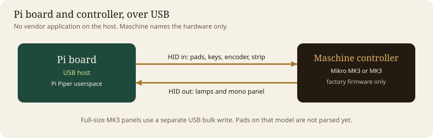

# Pi Piper

A stage framework for live performance on a small board, speaking USB to compatible pad controllers.

**Repository:** [github.com/pingocreativetechnology/pi-piper](https://github.com/pingocreativetechnology/pi-piper)

**Site:** [pipiper.pingocreativetechnology.com](https://pipiper.pingocreativetechnology.com)

**Pingo Creative Technology:** [pingocreativetechnology.com](https://pingocreativetechnology.com)

Pi Piper is an independent, solo open-source framework for live performance on compatible pad controllers. Pi Piper is **compatible with** Native Instruments Maschine hardware. It is **not** affiliated with, endorsed by, or sponsored by Native Instruments / inMusic Brands, Inc. or their affiliates, and it is **not** made by them. “Maschine,” “Native Instruments,” and related marks are trademarks of their respective owners and are used solely to identify compatible third-party hardware. Pi Piper does not ship Native Instruments logos, branding, firmware, samples, fonts, manuals, or proprietary software. Raspberry Pi is a trademark of Raspberry Pi Ltd. Use of Pi Piper is at your own risk.

The working licence is MIT. That choice is open until Kenneth confirms it. See [docs/licence.md](docs/licence.md).

## How the pieces connect

USB between the board and the controller:



From a finger on a pad to low-latency audio:


The launcher and the starter apps. Shift+Stop on the hardware returns to the launcher.


## What you can do with it

- Boot a Lite system image straight into the performance launcher. The root filesystem is an overlay, so pulling the power on stage does not corrupt the card. SSH still works for updates.
- Read pads (velocity and aftertouch), keys, the encoder and the touch strip, and drive lamps and the mono panel, on the Mikro MK3.
- Hear the same apps through a virtual MIDI port named `Pi Piper`, and through OSC at `/pipiper`, so Pure Data or SuperCollider can be the sound.
- Write another app in Python. A one-file example is `examples/hello_app.py`.
- Develop without the hardware. `pi-piper sim` is the controller, in the browser and in the terminal.

Pi Piper is compatible with the Native Instruments Maschine Mikro MK3 and, for the two colour panels only, the Maschine MK3. It does not use, ship, or talk to any Native Instruments application.

The full-size MK3's pads and keys are not implemented yet. Colour panels on that model work; pad and key input for it is still to come. See [docs/legal-flags.md](docs/legal-flags.md) for the current compatibility limits.

## Bench, without hardware

```bash
python3 -m venv .venv && . .venv/bin/activate
pip install -e '.[dev,midi]'
# terminal one
PYTHONPATH=src python3 -m pi_piper sim --host 127.0.0.1 --port 44732
# terminal two
cd sim-web && npm install && npm run dev
```

After `pip install`, the command is `pi-piper`. From a checkout, `python3 -m pi_piper` is the same program.

Open the dev server at [http://127.0.0.1:44731](http://127.0.0.1:44731). The page is the bench: sixteen pads, the keys, the encoder, the strip, and the mono panel. The notice along the bottom stays on screen.

Keys on the bench match the terminal: `1234`, `qwer`, `asdf`, `zxcv` are the pads, arrows turn the encoder, Enter presses it, Space is Play, Tab holds Shift.

```bash
PYTHONPATH=src python3 -m pi_piper tui
```

Same apps, no browser. `PYTHONPATH=src python3 -m pytest` is the automated check.

## On the hardware

Flash Raspberry Pi OS Lite and run the provisioner, or build a card with pi-gen. Both are in [docs/flashing.md](docs/flashing.md). The parts, with no shops and no prices, are in [docs/parts.md](docs/parts.md).

```bash
sudo PI_PIPER_USER=performer PI_PIPER_ENABLE_OVERLAY=1 bash image/provision.sh
sudo reboot
```

The console prints the independence notice, then the launcher waits for a controller. Shift+Stop on the hardware returns to the launcher from any app. `pi-piper doctor` reports the kernel, the overlay, PipeWire, and the udev rule.

Updates over SSH go through a writable maintenance boot: `sudo pi-piper-update`. Details are in the flashing guide.

## The three performances

| App | What it does |
|---|---|
| Steps | Sixteen steps, four drum tracks (kick, snare, hat, clap) on MIDI channel 10. Encoder changes tempo. Swing cycles 50, 58, 66 percent. |
| Clips | Four scenes by four tracks. A pad launches that clip on the next bar. |
| MIDI | The grid plays notes from a movable root. Keys send controllers. The strip is expression. Incoming notes light the pads. |

Patterns in Clips were written for this project. There are no factory kits.

## Write an app

```python
from pi_piper.model import PadEvent, PadPhase
from pi_piper.sdk import App

class Hello(App):
    id = "hello"
    title = "Hello"
    hint = "Strike a pad."

    def on_event(self, host, event):
        if isinstance(event, PadEvent) and event.phase is PadPhase.STRIKE:
            host.note(0, 60 + event.index, 100, gate=0.2)
            host.pad(event.index, "mint", 3)

    def paint(self, host):
        host.screen.text(0, 0, "HELLO")
```

```bash
PYTHONPATH=src python3 -m pi_piper sim --app examples/hello_app.py
```

`paint` redraws every tick. The engine clears the lamps first. Sound leaves through `host.note`, `host.midi`, and `host.osc`. The layout of the Python package is in [docs/architecture.md](docs/architecture.md).

Pure Data and SuperCollider bridges are in [bridges/](bridges/README.md). They listen; they are not required for the launcher.

## Tests on the real unit

[docs/hardware-test.md](docs/hardware-test.md) is the checklist. The simulator is not a substitute for it.

## Contributing

[CONTRIBUTING.md](CONTRIBUTING.md). Sign off with the Developer Certificate of Origin. Do not add GPL application code without the licence conversation in `docs/licence.md`.

---

Site: [pipiper.pingocreativetechnology.com](https://pipiper.pingocreativetechnology.com)

Made by [PCT](https://pingocreativetechnology.com).

[Buy Me a Coffee](https://buymeacoffee.com/pingoism)
